# crew-progress

A Claude Code mod: a live panel of your crew (the main session plus every subagent) and a progress bar above the prompt. It is a fork of [savvy-progress](https://github.com/johnnyvizz/claude-kit/tree/main/plugins/savvy-progress) by [johnnyvizz](https://github.com/johnnyvizz), MIT licensed, with two additions:

- **Main session row.** The panel's first row is the main session itself, wearing a crown: its model and effort, how full its context window is, an estimated cost, and how long the session has run. It walks while a main turn runs and rests between turns.
- **A costume per workflow profile.** A subagent is drawn as the profile it was dispatched with, each with its own pixel-crab costume and colour, instead of the generic crab.

Everything else works as in savvy-progress: running, finished and planned subagents with model, effort, task progress, context, estimated cost and time; the savvy-flow tiers (their names, colours and models, drawn as the plain crab since 0.4.0); the progress bar for orchestrated flows.

## Costume gallery

Every crab the mod ships, as it looks while its agent runs (`prefers-reduced-motion` stops the animation). The images are generated from the drawing code; see [Development](#development).

<table>
<tr><td align="center" width="25%"><br><b><a href="https://github.com/Densetsu152637/Agent-Custom-Workflow/blob/main/workflows/AGENTS.root.md">root</a></b><br><sub>gold crown with jewels; the jewels sparkle</sub></td><td align="center" width="25%"><br><b><a href="https://github.com/Densetsu152637/Agent-Custom-Workflow/blob/main/workflows/AGENTS.manager.md">manager</a></b><br><sub>headset with mic and a conductor's baton; the baton conducts</sub></td><td align="center" width="25%"><br><b><a href="https://github.com/Densetsu152637/Agent-Custom-Workflow/blob/main/profiles/AGENTS.explorer.md">explorer</a></b><br><sub>pith helmet and a lantern; the lantern swings</sub></td><td align="center" width="25%"><br><b><a href="https://github.com/Densetsu152637/Agent-Custom-Workflow/blob/main/profiles/AGENTS.implementer.md">implementer</a></b><br><sub>bandana and a claw hammer; the hammer strikes</sub></td></tr>
<tr><td align="center" width="25%"><br><b><a href="https://github.com/Densetsu152637/Agent-Custom-Workflow/blob/main/profiles/AGENTS.documenter.md">documenter</a></b><br><sub>scroll and a quill; the quill writes</sub></td><td align="center" width="25%"><br><b><a href="https://github.com/Densetsu152637/Agent-Custom-Workflow/blob/main/profiles/AGENTS.tester.md">tester</a></b><br><sub>lab goggles and a flask; the bubbles rise</sub></td><td align="center" width="25%"><br><b><a href="https://github.com/Densetsu152637/Agent-Custom-Workflow/blob/main/profiles/AGENTS.validator.md">validator</a></b><br><sub>visor cap and a clipboard; the check mark blinks</sub></td><td align="center" width="25%"><br><b><a href="https://github.com/Densetsu152637/Agent-Custom-Workflow/blob/main/profiles/AGENTS.critic.md">critic</a></b><br><sub>beret and a gold monocle; the monocle glints</sub></td></tr>
</table>

**Domain profiles**

<table>
<tr><td align="center" width="25%"><br><b><a href="https://github.com/Densetsu152637/Agent-Custom-Workflow/blob/main/profiles/AGENTS.researcher.md">researcher</a></b><br><sub>mortarboard and an open book; the page flips</sub><br><sub>workflow: <a href="https://github.com/Densetsu152637/Agent-Custom-Workflow/blob/main/workflows/AGENTS.research.md">research</a></sub></td><td align="center" width="25%"><br><b><a href="https://github.com/Densetsu152637/Agent-Custom-Workflow/blob/main/profiles/AGENTS.debugger.md">debugger</a></b><br><sub>bug net and a ladybird; the net swings, the bug buzzes</sub><br><sub>workflow: <a href="https://github.com/Densetsu152637/Agent-Custom-Workflow/blob/main/workflows/AGENTS.debugging.md">debugging</a></sub></td><td align="center" width="25%"><br><b><a href="https://github.com/Densetsu152637/Agent-Custom-Workflow/blob/main/profiles/AGENTS.analyst.md">analyst</a></b><br><sub>tie and a bar-chart board; the bars rise</sub><br><sub>workflow: <a href="https://github.com/Densetsu152637/Agent-Custom-Workflow/blob/main/workflows/AGENTS.data-analysis.md">data-analysis</a></sub></td><td align="center" width="25%"><br><b><a href="https://github.com/Densetsu152637/Agent-Custom-Workflow/blob/main/profiles/AGENTS.architect.md">architect</a></b><br><sub>blueprint roll and a set square; the set square measures</sub><br><sub>workflow: <a href="https://github.com/Densetsu152637/Agent-Custom-Workflow/blob/main/workflows/AGENTS.architecture.md">architecture</a></sub></td></tr>
<tr><td align="center" width="25%"><br><b><a href="https://github.com/Densetsu152637/Agent-Custom-Workflow/blob/main/profiles/AGENTS.auditor.md">auditor</a></b><br><sub>shield with a padlock; the padlock glints</sub><br><sub>workflow: <a href="https://github.com/Densetsu152637/Agent-Custom-Workflow/blob/main/workflows/AGENTS.security.md">security</a></sub></td><td align="center" width="25%"><br><b><a href="https://github.com/Densetsu152637/Agent-Custom-Workflow/blob/main/profiles/AGENTS.navigator.md">navigator</a></b><br><sub>browser window with a cursor; the cursor clicks a link</sub><br><sub>workflow: <a href="https://github.com/Densetsu152637/Agent-Custom-Workflow/blob/main/workflows/AGENTS.browser.md">browser</a></sub></td><td align="center" width="25%"><br><b><a href="https://github.com/Densetsu152637/Agent-Custom-Workflow/blob/main/profiles/AGENTS.inspector.md">inspector</a></b><br><sub>headphones and a camera; the flash fires, a note rises</sub><br><sub>workflow: <a href="https://github.com/Densetsu152637/Agent-Custom-Workflow/blob/main/workflows/AGENTS.vision.md">vision</a>, <a href="https://github.com/Densetsu152637/Agent-Custom-Workflow/blob/main/workflows/AGENTS.audio.md">audio</a>, <a href="https://github.com/Densetsu152637/Agent-Custom-Workflow/blob/main/workflows/AGENTS.video.md">video</a></sub></td><td align="center" width="25%"><br><b>any other agent</b><br><sub>the plain crab, labelled with its agent type or savvy-flow tier; walks</sub></td></tr>
</table>

**Retired in 0.4.0:** the savvy-flow tier costumes (fable astronaut, heavy detective, careful engineer, medium chef, light racer) and the built-in Explore agent's pirate. Those agents now wear the plain crab; savvy-flow agents keep their tier word, colour and model, and the progress tools are unchanged.

## Install

At the prompt of a terminal session:

```
/plugin install crew-progress --marketplace Densetsu152637/Crew-Progress
```

From a shell:

```
claude plugin install crew-progress --marketplace Densetsu152637/Crew-Progress
```

In the desktop app, where `/plugin` does not run: click + next to the prompt box, then Plugins, Add marketplace with `Densetsu152637/Crew-Progress`, then Add plugin.

crew-progress uses its own names throughout (`/crew`, the `crew-agents` pane, `mcp__crew-progress__*` tools), so it can be installed beside savvy-progress; you will usually want only one of them enabled, since both draw a panel.

## Using it

- `/crew` shows or hides the panel; `/crew open` opens it, or brings it forward, without toggling.
- With the default `autoOpen: any`, the panel opens by itself once per session when a subagent starts, and whenever a flow reports a plan.

### The main session row

| Shown | Where it comes from |
| --- | --- |
| Model and effort | The main loop's latest model request (`turn.step`); `—` until the first one after the mod loads. |
| Context | The engine's own measure of the live window after each main turn (`session.measure`, `SessionContextUsage`), and the request's input side between measures. |
| Estimated cost | Each main-loop request's token counts priced with the same table as the subagents (`PRICES` in `hooks/register.tsx`). |
| Time | Since the session began (`$.session.usage().startedAt`). |

The cost is an estimate and counts only requests made while the mod is loaded: requests from before it loaded are not in it. The row is not reset by `/clear` (its cost, tokens and time keep counting from the first start). The engine's own ledger (`/cost`) also includes subagents, so it is not used for this row.

### Profiles and costumes

A subagent's costume is picked in this order, the first match winning:

1. Its agent type is a profile name, e.g. `implementer` or `my-plugin:implementer`.
2. Its brief carries a tag such as `Role: leaf; Profile: implementer` anywhere in it ([the brief tag convention](https://github.com/Densetsu152637/Agent-Custom-Workflow/blob/main/templates/subagent-brief.md#compact-schema)); the first `Profile:` counts.
3. Otherwise the plain crab, labelled with its savvy-flow tier (`savvy-careful` shows `careful`) or else its agent type (e.g. `Explore`).

The profiles are those of [Agent-Custom-Workflow](https://github.com/Densetsu152637/Agent-Custom-Workflow): `manager`; the generic `explorer`, `implementer`, `validator`, `critic`, `documenter` and `tester`; and the domain profiles `researcher`, `debugger`, `analyst`, `architect`, `auditor`, `navigator` and `inspector`. The [costume gallery](#costume-gallery) shows each one and links its profile and workflow files.

The profile's name appears under the agent's title, where savvy-flow agents show their tier. `prefers-reduced-motion` stops every animation.

## Tools it adds

- `mcp__crew-progress__progress`: an orchestrator reports the plan, phase and accepted tasks for the progress bar. Only the main session can; a call from a subagent is ignored.
- `mcp__crew-progress__step`: a subagent reports its own steps (`done`, `total`, `note`). A worker that does not report shows its context fill in grey instead. `savvy-*` workers get one line at the end of their brief asking for these reports.

Costs are rough estimates from token counts and list prices (as of 2026-10-10), not a bill. Cache writes are priced at the 1-hour rate.

## Settings

`language`: `auto` (default), `en`, `ru` or `he`. Hebrew draws the bar and the panel right to left. `auto` follows Claude Code's `language` setting, then the system locale, and falls back to English.

`autoOpen`: `any` (default) or `savvy`. With `any` the panel also opens, once per session, when any subagent starts; with `savvy` only for savvy-flow workers and reported plans.

`openAtStart`: `on` (default) or `off`. With `on` the panel opens when a session starts (once per session, so closing it stays closed); with `off` it opens only per `autoOpen` or `/crew`.

Set them in `/config`, or in `~/.claude/settings.json`:

```json
{ "pluginConfigs": { "crew-progress": { "options": { "language": "en", "autoOpen": "any", "openAtStart": "on" } } } }
```

## Development

`claude plugin validate .` checks the manifest and the hooks module; `claude plugin test .` runs the tests in `hooks/*.test.ts(x)`.

The crab drawings live in `hooks/crabs.ts` (pixel grids, `COSTUMES`, `CRAB_CSS`), which `hooks/register.tsx` imports. After changing a costume, regenerate the gallery images with Node 22.18 or later, which runs the TypeScript directly:

```
node tools/render-costumes.mjs          # writes media/costumes/<costume>.svg, one per COSTUMES entry
node tools/render-costumes.mjs --check  # exits 1 when an image is missing, stale or has no costume
```

The test harness cannot read files, so the `Costumes` GitHub Actions workflow (`.github/workflows/costumes.yml`) runs the `--check` on every push to `main` and every pull request.

## Credits and licence

Built on [savvy-progress](https://github.com/johnnyvizz/claude-kit/tree/main/plugins/savvy-progress) by johnnyvizz: the panel, the progress bar, the cost table and the pixel crabs (themselves after DockCrab's Clawd). MIT licence; see [LICENSE](LICENSE), which carries both copyrights.
